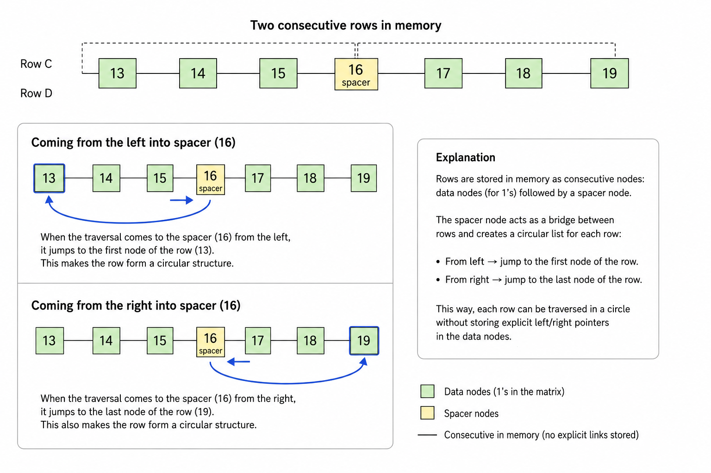

## Dancing Links (DLX)

SudoScan uses **Dancing Links (DLX)**, a technique introduced by Donald Knuth for efficiently implementing Algorithm X, a recursive, depth-first search algorithm for solving the **exact cover problem**.

Given a collection of sets, the exact cover problem asks us to select a subset of those sets such that every element is covered exactly once. The problem has applications beyond Sudoku, including tiling problems and other combinatorial problems.

### A Simple Exact Cover Example

Consider the following binary matrix, where each row represents a set and each column represents an element to be covered.

```text
    1 2 3 4 5
A   1 0 1 1 0
B   0 1 0 0 0
C   1 1 0 0 1
D   1 0 1 0 1
E   0 1 0 0 1
F   0 1 1 0 0
```

The goal is to select rows such that every column contains exactly one selected `1`.

In this example, **rows A and E form an exact cover**. Together, they cover all five columns, with each column covered exactly once.




### Formulating Sudoku as Exact Cover

A standard 9×9 Sudoku can be formulated as an exact cover problem using a sparse binary matrix.

There are 81 cells, and each cell can contain one of nine digits, giving 729 possible assignments. Each assignment corresponds to one row in the matrix.

The Sudoku rules can be expressed as four groups of constraints:

- **Cell constraint:** Each cell must contain exactly one digit.
- **Row constraint:** Each digit must appear exactly once in each row.
- **Column constraint:** Each digit must appear exactly once in each column.
- **Box constraint:** Each digit must appear exactly once in each 3×3 box.

Each group contains 81 constraints, resulting in a matrix with **729 rows and 324 columns** (\(9 \times 81\) rows and \(4 \times 81\) columns).

Each row represents a possible assignment of a digit to a cell. It contains exactly four `1`s, one for each constraint satisfied by that assignment. All other entries are `0`.

The rows are grouped by cell: the first nine rows represent the possible digits for the first cell, the next nine represent the possibilities for the second cell, and so on.

An exact cover selects assignments that satisfy every constraint exactly once. These assignments form a completed Sudoku grid. If there is exactly one exact cover, the puzzle has a unique solution. Multiple exact covers indicate multiple solutions, while no exact cover means the puzzle is unsolvable.

### The Dancing Links Data Structure

Dancing Links uses a linked data structure that allows nodes to be removed and restored efficiently during backtracking.

In *The Art of Computer Programming, Volume 4, Pre-Fascicle 5C: Dancing Links* (2019), Donald Knuth discusses spacer nodes as an alternative way to represent horizontal links.

In SudoScan, all nodes share the same data structure and are stored in a contiguous block of memory. The `LEFT` and `RIGHT` fields are used only by column header nodes; for other nodes, these fields are set to `-1`.

**Horizontal links**

The column headers form a circular doubly linked list using `LEFT` and `RIGHT` links. This allows a column header to be removed from the active list and restored later without deleting it from memory.

**Spacer nodes**

Data nodes within each row are stored consecutively in memory. A spacer node marks the end of each row and provides a way to traverse the row in both directions without storing explicit `LEFT` and `RIGHT` links in every data node.

When traversal reaches a spacer from the left, it jumps to the first data node of the row. When traversal reaches it from the right, it jumps to the last data node.



**Vertical links**

Each column contains a circular doubly linked list of data nodes representing the `1` entries in that column. These nodes are connected through `UP` and `DOWN` links, with the column header serving as the anchor of the list.

When a row is hidden, its data nodes are temporarily unlinked from their respective vertical lists. The nodes remain in memory, retaining the link information needed to restore them later.

### Cover and Hide Operations

The `cover(col)` operation removes a column header from the active header list and calls `hide(row)` for each data node in that column.

The `hide(row)` operation traverses the other data nodes in the row, using the spacer to complete the circular traversal. Each encountered data node is unlinked from its vertical list, and the corresponding column length is decremented.

This temporarily excludes conflicting candidates from the search without deleting the nodes from memory.

#### Example: Covering Column 4

Consider the same 6×5 matrix used in the earlier example. The column lengths are:

| Column | Length |
|---|---:|
| 1 | 3 |
| 2 | 4 |
| 3 | 3 |
| 4 | 1 |
| 5 | 3 |

The Minimum Remaining Values (MRV) heuristic selects column 4 because it has the fewest remaining candidates. Its only `1` is in row A.


The `cover(4)` operation removes the links between column headers 3 and 4, and between headers 4 and 5. It then connects headers 3 and 5 directly, excluding column 4 from the active header list. The column header and its data nodes remain in memory.

Next, `hide(9)` processes the other data nodes in row A.

The traversal starts at the spacer (node 10), jumps through its `UP` link to the first data node (node 7), and processes nodes 7 and 8. It stops before reaching node 9.

- **Node 7** is unlinked from column 1. The links `1 → 7` and `7 → 13` are replaced by `1 → 13`, and the column length decreases from 3 to 2.
- **Node 8** is unlinked from column 3. The links `3 → 8` and `8 → 18` are replaced by `3 → 18`, and the column length decreases from 3 to 2.

Row A's nodes 7, 8, 9, and spacer 10 are shown dimmed in the illustration. Node 9 is not processed by the `hide()` loop and remains in its vertical list. Its column header has been removed from the active header list, but its vertical links remain unchanged.

The removed nodes retain their own `UP` and `DOWN` values, allowing the original structure to be restored later.

### Uncover and Unhide Operations

The `uncover(col)` and `unhide(row)` operations reverse the changes made by `cover(col)` and `hide(row)`. Restoration is performed in the opposite order to removal, which is essential for preserving the original links and column lengths.

#### Example: Uncovering Column 4

<!-- TODO: Add the uncover-column-4 illustration here -->

The `uncover(4)` operation traverses the column's data nodes from bottom to top and calls `unhide(row)` for each one.

In the example, `unhide(9)` traverses row A in the opposite direction to `hide(9)`. It processes node 8 first and node 7 second, stopping at spacer node 6, whose `DOWN` link points to node 9.

- **Node 8** is reinserted into column 3. The links `3 → 8` and `8 → 18` are restored, and the column length increases from 2 to 3.
- **Node 7** is reinserted into column 1. The links `1 → 7` and `7 → 13` are restored, and the column length increases from 2 to 3.

Finally, `uncover(4)` restores the header list by setting the neighbouring headers' links back to column 4:

```cpp
m_nodes[left].right = col;
m_nodes[right].left = col;
```

This restores the original header links `3 ↔ 4 ↔ 5`.

The bypass links created during `cover(4)` are no longer active. All affected column lengths and links have been restored, leaving the data structure ready for the next step in the search.

### Column Selection and Backtracking

Algorithm X solves the exact cover problem using recursive, depth-first search with backtracking.

At each step, the solver selects an uncovered column and tries each row containing a `1` in that column. Selecting a row satisfies its constraints, so the corresponding columns are covered and conflicting rows are hidden from the search.

The solver then recursively solves the reduced problem. If a choice leads to a dead end, it backtracks by uncovering the affected columns and unhiding the rows, restoring the structure before trying another candidate.

SudoScan uses the **Minimum Remaining Values (MRV)** heuristic to select the active column with the fewest remaining candidate rows. This reduces the branching factor of the search.

For randomized Sudoku generation, the solver instead selects randomly among the columns tied for the minimum length. This retains the MRV heuristic while introducing variation into the search order.

The search succeeds when all columns have been covered. The selected rows then form an exact cover and, for Sudoku, a complete solution.

### Further Reading

For the original treatment of Algorithm X and Dancing Links, see Donald Knuth's work:

- [Dancing Links — Donald E. Knuth (Pre-Fascicle 5C, 2019)](https://cs.stanford.edu/~knuth/fasc5c.ps.gz)
- [The Art of Computer Programming — Official website](https://cs.stanford.edu/~knuth/taocp.html)
