# SudoScan

SudoScan is a desktop application for solving, creating, and managing Sudoku puzzles. It combines an interactive Sudoku interface with an efficient solving algorithm and image recognition capabilities.

Sudoku puzzles can be generated automatically, entered manually, or imported from photographs. The built-in image recognition pipeline processes the image and identifies the digits, allowing the user to review and correct the results before solving. Images can also be transferred directly from a mobile phone using a QR-code-based transfer system.

The application is built with C++17 and Qt 6, with a separate Python-based service handling image transfers. Its solving engine uses the Dancing Links (DLX) algorithm to efficiently solve Sudoku puzzles and generate valid puzzles with unique solutions.

<p align="center">
  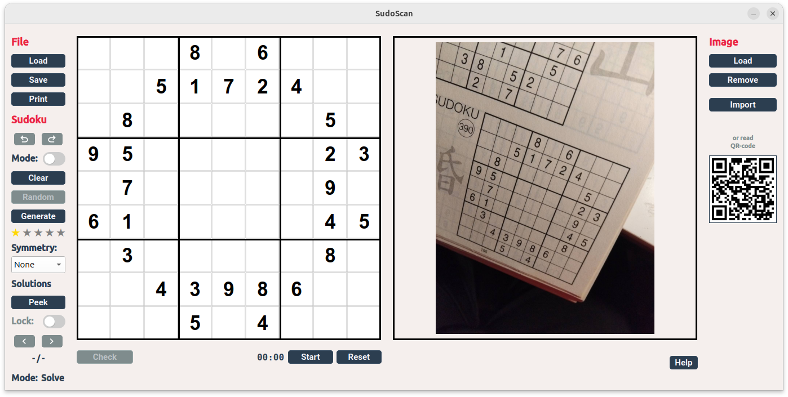
  <em>Main view</em>
</p>


## Features

### Sudoku Solving

SudoScan provides an interactive Sudoku interface with tools for both solving and creating puzzles.

**Solve Mode**
- Enter and solve Sudoku puzzles manually.
- Add pencil marks using corner or center notation.
- Use the Peek feature to temporarily reveal the solution.
- Check the current solution.
- Track solving time.
- Undo and redo moves.

**Edit Clues Mode**
- Generate a random, fully solved Sudoku grid.
- Create custom puzzles by removing numbers from the generated grid.
- Enter clue numbers, which are displayed in black.
- View the number of solutions found (up to 25).

<p align="center">
  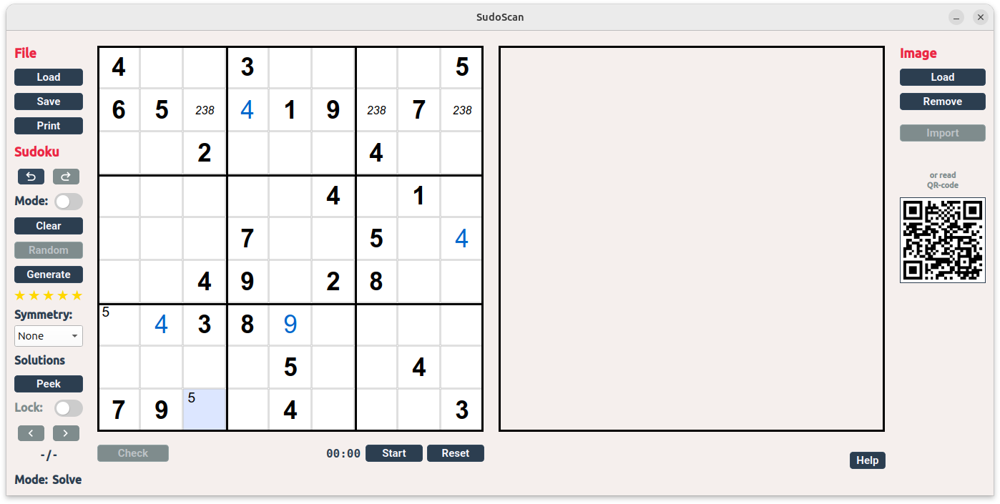
  <em>Solving puzzle using center marks and corner marks</em>
</p>

### Image Recognition

Sudoku puzzles can be imported directly from photographs. The image processing pipeline detects the Sudoku grid, corrects perspective distortion, and prepares individual cells for digit recognition using Tesseract OCR.

Recognized digits are transferred to the Sudoku grid, where they can be reviewed and corrected before solving.

### Puzzle Generation and Lock Mode

SudoScan uses the Dancing Links (DLX) algorithm to generate random, fully solved Sudoku grids.

Puzzles can be created by removing numbers from a randomly generated, fully solved grid. Users can also create puzzles manually using Edit Clues mode.

**Lock Mode** provides a way to explore the solutions of a puzzle. Solutions can be browsed when there are up to 25, while puzzles with more solutions use randomly selected solutions.

<table>
  <tr>
    <td align="center" width="50%">
      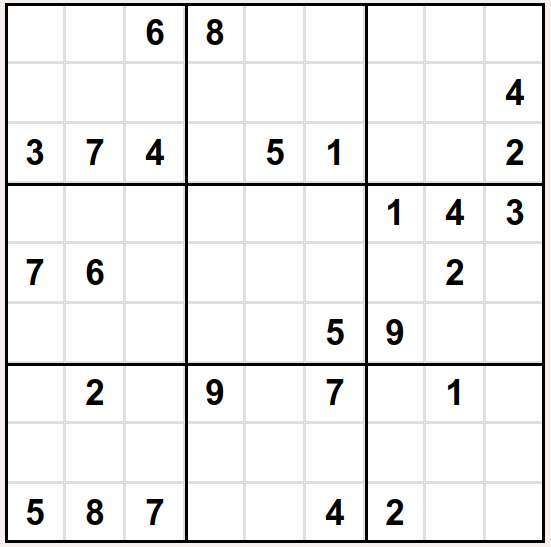
      <br>
      <em>Generated puzzle</em>
    </td>
    <td align="center" width="50%">
      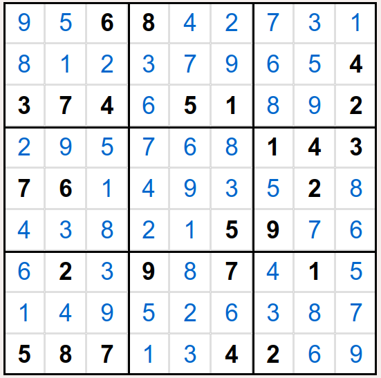
      <br>
      <em>Solution</em>
    </td>
  </tr>
  
</table>

### QR Image Transfer

Images can be transferred directly from a mobile phone to SudoScan using a QR code.

The application creates a temporary session and displays a QR code that can be scanned with a phone. The image is uploaded through a separate FastAPI service and retrieved by the desktop application.


<p align="center">
  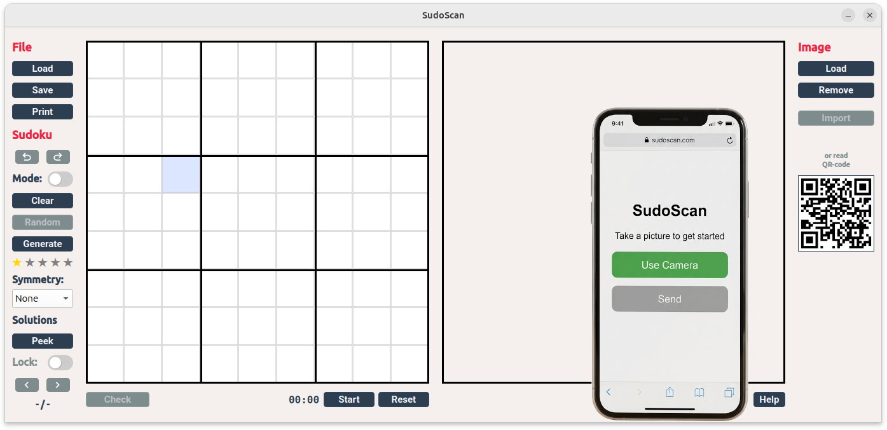
</p>

### Saving and Printing

- Save and load Sudoku puzzles in JSON format.
- Print puzzles using the built-in print preview.
- Export puzzles to PDF through the print dialog.
  
## Technologies

SudoScan is built using the following technologies and libraries:

| Technology               | Purpose                                     |
| ------------------------ | ------------------------------------------- |
| C++17                    | Main application language                   |
| Qt 6                     | GUI framework                               |
| Qt JSON                  | JSON serialization and deserialization      |
| Qt Print Support         | Print preview and PDF export                |
| OpenCV                   | Image processing and perspective correction |
| Tesseract OCR            | Digit recognition                           |
| Python                   | Image transfer service                      |
| FastAPI                  | HTTP API for image transfers                |
| Nayuki QR Code Generator (qrcodegen) | QR code generation                          |
| CMake                    | Build system                                |

### Algorithms

**Dancing Links (DLX)**

The Sudoku solver is based on Donald Knuth's Dancing Links algorithm, an efficient implementation of Algorithm X for solving exact cover problems.
## Image Processing and Digit Recognition

SudoScan uses OpenCV for image preprocessing and Tesseract OCR for digit recognition. The reader pipeline transforms a photograph of a Sudoku puzzle into a 9 × 9 grid of recognized digits.

### 1. Grid Detection

The input image is first resized if its width exceeds 1200 pixels. It is then converted to grayscale, blurred, and binarized using adaptive Gaussian thresholding. Morphological closing helps connect small gaps in the detected structures.

OpenCV contour detection is used to find a large quadrilateral candidate corresponding to the Sudoku grid. The surrounding rectangular region is cropped from the original image.

### 2. Perspective Correction

The cropped image is processed to detect the Sudoku grid's four corners. The corners are ordered and used to calculate a perspective transformation.

The image is then warped into a square of 900 × 900 pixels, providing a normalized view of the grid.

<table>
  <tr>
    <td align="center" width="50%">
      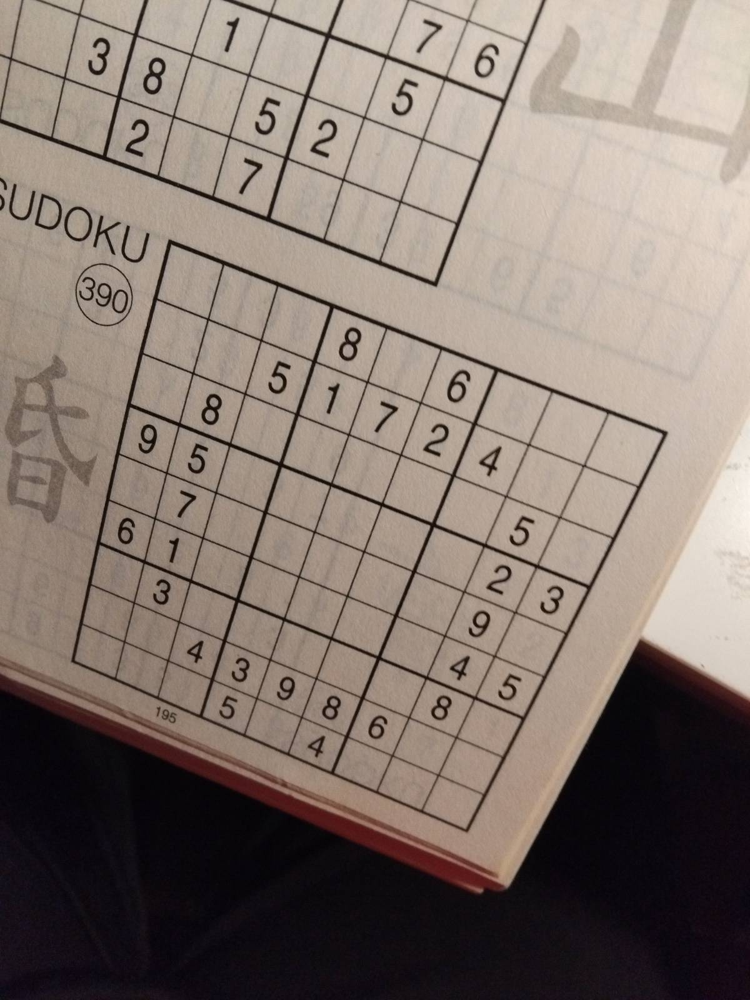
      <br>
      <em>Original image</em>
    </td>
    <td align="center" width="50%">
      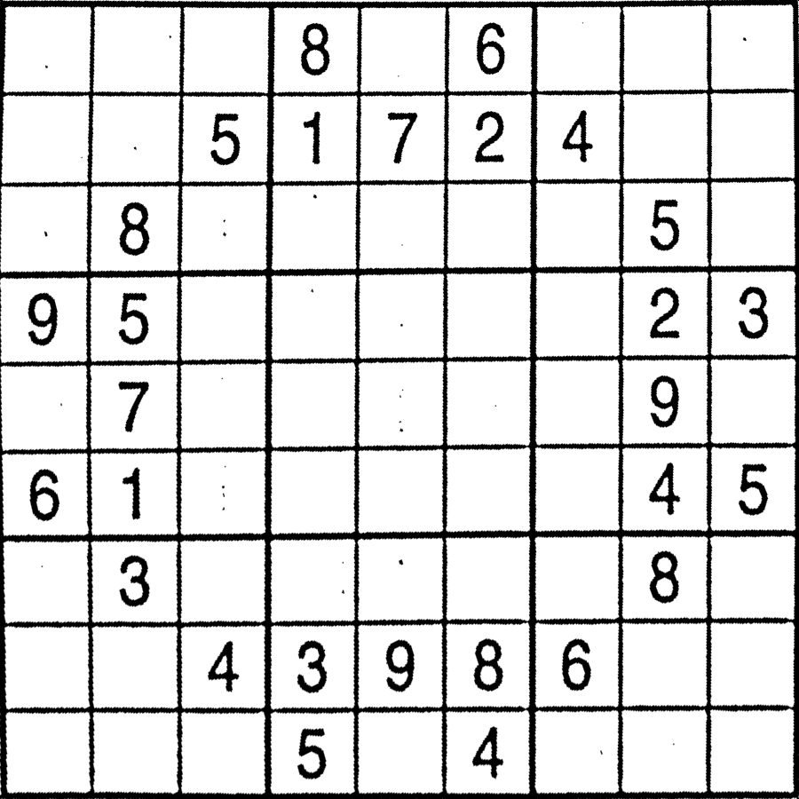
      <br>
      <em>Perspective-corrected image</em>
    </td>
  </tr>  
</table>
<em>Perspective correction transforms an oblique photograph of a Sudoku puzzle into a normalized square image for cell extraction and digit recognition.</em>

### 3. Cell Preprocessing

The normalized grid is divided into 81 cells. Each cell is processed individually to isolate its digit from the surrounding grid lines.

The detected digit is cropped, padded, resized while preserving its aspect ratio, and centered on a 100 × 100 pixel canvas. Small contours are removed to reduce noise before OCR.

If no suitable digit contour is found, an empty image is returned for the cell.

### 4. Digit Recognition

Tesseract OCR recognizes one character at a time. Recognition is restricted to the digits 1–9, and a confidence threshold is used to filter uncertain results.

A recognized digit is accepted only when the output begins with a digit from 1 to 9 and the mean text confidence exceeds 71. Otherwise, the cell is assigned the value `0`.

A zero therefore represents either an empty cell or a digit that could not be recognized with sufficient confidence.

### 5. Output

The reader returns a 9 × 9 Sudoku grid together with a processed image for display in the application. The recognized grid can then be reviewed and corrected by the user before solving.

<table>
  <tr>
    <td align="center" width="50%">
      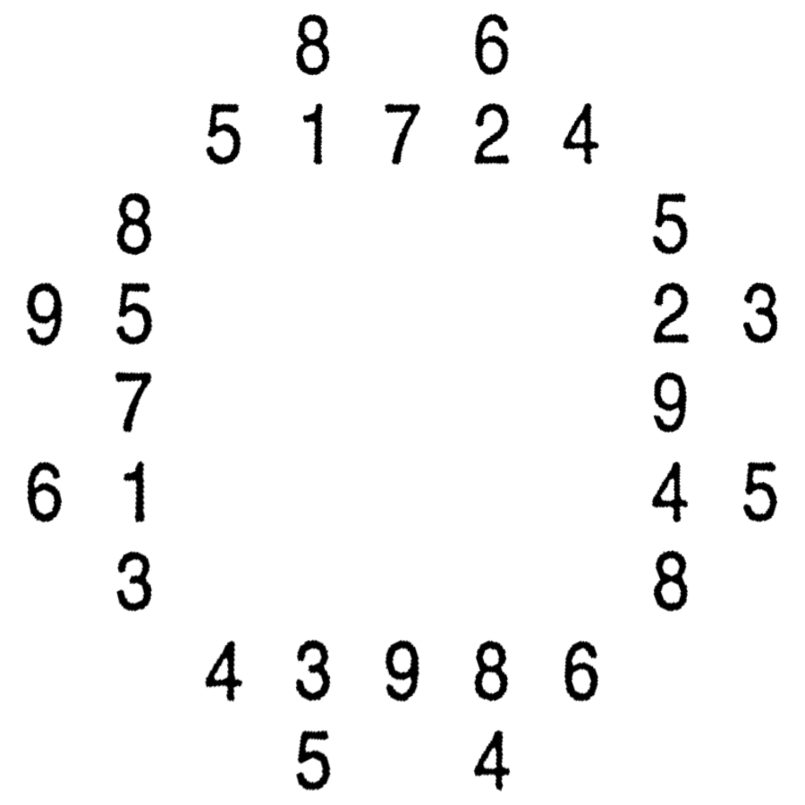
      <br>
      <em>Processed image</em>
    </td>
    <td align="center" width="50%">
      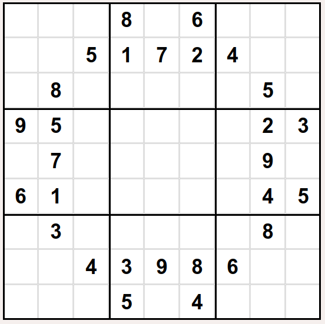
      <br>
      <em>Recognized Sudoku grid</em>
    </td>
  </tr>
</table>


## Dancing Links (DLX)

SudoScan uses **Dancing Links (DLX)**, a technique introduced by Donald Knuth for efficiently implementing Algorithm X, a recursive, depth-first search algorithm for solving the **exact cover problem**.

Given a collection of sets, the exact cover problem asks us to select a subset of those sets such that every element is covered exactly once. The problem has applications beyond Sudoku, including tiling problems and other combinatorial problems.

### A Simple Exact Cover Example

Consider the following binary matrix, where each row represents a set and each column represents an element to be covered.

The goal is to select rows such that every column contains exactly one selected `1`.

In this example, **rows A and E form an exact cover**. Together, they cover all five columns, with each column covered exactly once.

<div align="center">
  
</div>

### Formulating Sudoku as Exact Cover

A standard 9×9 Sudoku can be formulated as an exact cover problem using a sparse binary matrix.

There are 81 cells, and each cell can contain one of nine digits, giving 729 possible assignments. Each assignment corresponds to one row in the matrix.

The Sudoku rules can be expressed as four groups of constraints:

- **Cell constraint:** Each cell must contain exactly one digit.
- **Row constraint:** Each digit must appear exactly once in each row.
- **Column constraint:** Each digit must appear exactly once in each column.
- **Box constraint:** Each digit must appear exactly once in each 3×3 box.

Each group contains 81 constraints, resulting in a matrix with **729 rows and 324 columns** (9 x 81 rows and 4 x 81 columns).

Each row represents a possible assignment of a digit to a cell. It contains exactly four `1`s, one for each constraint satisfied by that assignment. All other entries are `0`.

The rows are grouped by cell: the first nine rows represent the possible digits for the first cell, the next nine represent the possibilities for the second cell, and so on.

An exact cover selects assignments that satisfy every constraint exactly once. These assignments form a completed Sudoku grid. If there is exactly one exact cover, the puzzle has a unique solution. Multiple exact covers correspond to multiple Sudoku solutions, while no exact cover means that the puzzle has no solution.

### The Dancing Links Data Structure

Dancing Links uses a linked data structure that allows nodes to be removed and restored efficiently during backtracking.

In *The Art of Computer Programming, Volume 4, Pre-Fascicle 5C: Dancing Links* (2019), Donald Knuth discusses spacer nodes as an alternative way to represent horizontal links.

In SudoScan, all nodes share the same data structure and are stored in a contiguous block of memory. The `LEFT` and `RIGHT` fields are used only by column header nodes; for other nodes, these fields are set to `-1`.

**Horizontal links**

The column headers form a circular doubly linked list using `LEFT` and `RIGHT` links. This allows a column header to be removed from the active list and restored later without deleting it from memory.

**Spacer nodes**

Data nodes within each row are stored consecutively in memory. A spacer node marks the end of each row and provides a way to traverse the row in both directions without storing explicit `LEFT` and `RIGHT` links in every data node.

When traversal reaches a spacer from the left, it jumps to the first data node of the row. When traversal reaches it from the right, it jumps to the last data node.

<div align="center">
  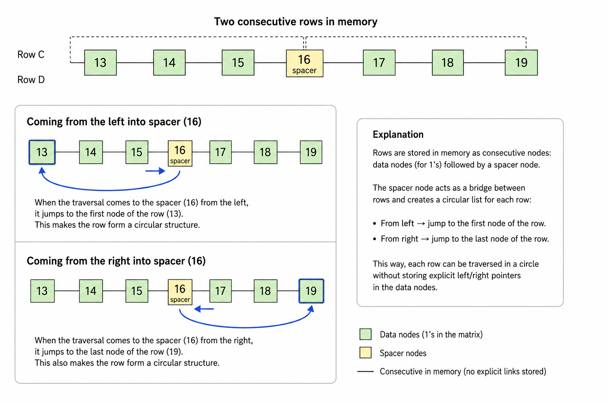
</div>

**Vertical links**

Each column contains a circular doubly linked list of data nodes representing the `1` entries in that column. These nodes are connected through `UP` and `DOWN` links, with the column header serving as the anchor of the list.

When a row is hidden, its data nodes are temporarily unlinked from their respective vertical lists. The nodes remain in memory, retaining the link information needed to restore them later.

<div align="center">
  
</div>

### Cover and Hide Operations

The `cover(col)` operation removes a column header from the active header list and calls `hide(row)` for each data node in that column.

The `hide(row)` operation traverses the other data nodes in the row, using the spacer to complete the circular traversal. Each encountered data node is unlinked from its vertical list, and the corresponding column length is decremented.

This temporarily excludes conflicting candidates from the search without deleting the nodes from memory.

#### Example: Covering Column 4

Consider the same 6×5 matrix used in the earlier example. The column lengths are:

| Column | Length |
| ------ | -----: |
| 1      |      3 |
| 2      |      4 |
| 3      |      3 |
| 4      |      1 |
| 5      |      3 |

The Minimum Remaining Values (MRV) heuristic selects column 4 because it has the fewest remaining candidates. Its only `1` is in row A.

<div align="center">
  
</div>

The `cover(4)` operation removes the links between column headers 3 and 4, and between headers 4 and 5. It then connects headers 3 and 5 directly, excluding column 4 from the active header list. The column header and its data nodes remain in memory.

Next, `hide(9)` processes the other data nodes in row A.

The traversal starts at the spacer (node 10), jumps through its `UP` link to the first data node (node 7), and processes nodes 7 and 8. It stops before reaching node 9.

- **Node 7** is unlinked from column 1. The links `1 → 7` and `7 → 13` are replaced by `1 → 13`, and the column length decreases from 3 to 2.
- **Node 8** is unlinked from column 3. The links `3 → 8` and `8 → 18` are replaced by `3 → 18`, and the column length decreases from 3 to 2.

Row A's nodes 7, 8, 9, and spacer 10 are shown dimmed in the illustration. Node 9 is not processed by the `hide()` loop and remains in its vertical list. Its column header has been removed from the active header list, but its vertical links remain unchanged.

The removed nodes retain their own `UP` and `DOWN` values, allowing the original structure to be restored later.

### Uncover and Unhide Operations

The `uncover(col)` and `unhide(row)` operations reverse the changes made by `cover(col)` and `hide(row)`. Restoration is performed in the opposite order to removal, which is essential for preserving the original links and column lengths.

#### Example: Uncovering Column 4

<div align="center">
  
</div>

The `uncover(4)` operation traverses the column's data nodes from bottom to top and calls `unhide(row)` for each one.

In the example, `unhide(9)` traverses row A in the opposite direction to `hide(9)`. It processes node 8 first and node 7 second, stopping at spacer node 6, whose `DOWN` link points to node 9.

- **Node 8** is reinserted into column 3. The links `3 → 8` and `8 → 18` are restored, and the column length increases from 2 to 3.
- **Node 7** is reinserted into column 1. The links `1 → 7` and `7 → 13` are restored, and the column length increases from 2 to 3.

Finally, `uncover(4)` restores the header list by setting the neighbouring headers' links back to column 4:

```cpp
m_nodes[left].right = col;
m_nodes[right].left = col;
```

This restores the original header links `3 ↔ 4 ↔ 5`.

The bypass links created during `cover(4)` are no longer active. All affected column lengths and links have been restored, leaving the data structure ready for the next step in the search.

### Column Selection and Backtracking

Algorithm X solves the exact cover problem using recursive, depth-first search with backtracking.

At each step, the solver selects an uncovered column and tries each row containing a `1` in that column. Selecting a row satisfies its constraints, so the corresponding columns are covered and conflicting rows are hidden from the search.

The solver then recursively solves the reduced problem. If a choice leads to a dead end, it backtracks by uncovering the affected columns and unhiding the rows, restoring the structure before trying another candidate.

SudoScan uses the **Minimum Remaining Values (MRV)** heuristic to select the active column with the fewest remaining candidate rows. This reduces the branching factor of the search.

For randomized Sudoku generation, the solver instead selects randomly among the columns tied for the minimum length. This retains the MRV heuristic while introducing variation into the search order.

The search succeeds when all columns have been covered. The selected rows then form an exact cover and, for Sudoku, a complete solution.

### Further Reading

For the original treatment of Algorithm X and Dancing Links, see Donald Knuth's work:

- [Dancing Links — Donald E. Knuth (Pre-Fascicle 5C, 2019)](https://cs.stanford.edu/~knuth/fasc5c.ps.gz)
- [The Art of Computer Programming — Official website](https://cs.stanford.edu/~knuth/taocp.html)

## QR Code Image Capture

SudoScan supports transferring Sudoku images directly from a mobile phone to the desktop application using a QR code. This eliminates the need to transfer photographs manually between devices.

### Architecture

The image transfer involves three components:

- **Qt desktop application:** Generates the QR code, manages the transfer session and retrieves the uploaded image.
- **FastAPI server:** Creates and maintains temporary sessions, receives image uploads and provides images for download.
- **Mobile browser:** Opens the capture page through the QR code and uploads the photograph to the server.

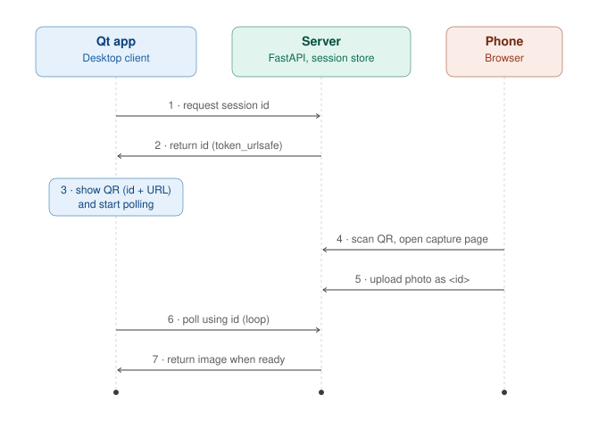

### Transfer Process

1. The Qt application requests a new session from the server.
2. The server generates a short, URL-safe session ID and returns it to the application. Keeping the ID short helps maintain a compact QR code that is easy to scan, even when displayed at a small size.
3. The application generates a QR code containing the capture page URL and the session ID.
4. The user scans the QR code with a phone, opening the capture page in the mobile browser.
5. The user takes a photograph and uploads it to the server using the session ID.
6. Meanwhile, the Qt application periodically polls the server to check whether an image has been uploaded.
7. Once the image is available, the application downloads it and passes the image data to the Sudoku image processing pipeline.

### Session Management

Each transfer uses a unique session ID. The server validates the ID before accepting an upload, preventing uploads to invalid or expired sessions.

The desktop application uses asynchronous HTTP requests and polls the server every 500 milliseconds. Once an image is available, polling stops and the application downloads it.

Each uploaded image is treated as a single-use resource. After a successful download, the server schedules the file for deletion. A background cleanup task also removes expired sessions and old image files.

After a successful transfer, the desktop application automatically creates a new session and displays a new QR code, ready for the next photograph.

## Downloads

Pre-built versions of SudoScan are available on the [GitHub Releases](RELEASES_URL) page.

## License

SudoScan is licensed under the MIT License. See the [LICENSE](LICENSE) file for details.

## Contact

For questions, feedback, or suggestions, feel free to contact me:

**Email:** joni.nordlund@gmail.com
